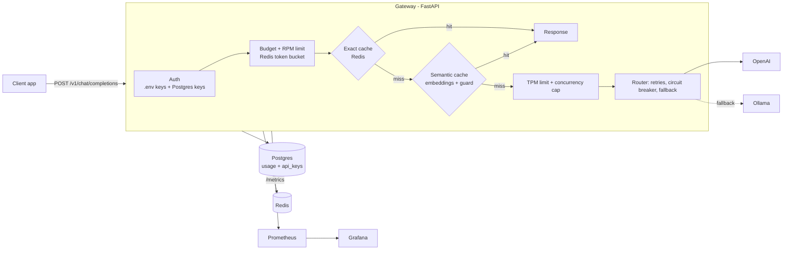

# LLM Gateway

A self-hosted proxy that sits between your applications and LLM providers. Apps talk to one
OpenAI-compatible endpoint; the gateway handles **reliability, cost control, caching and visibility**.

- **Reliability:** timeouts, retries with backoff, circuit breaker, automatic fallback OpenAI → Ollama
- **Cost control:** per-key rate limits (requests and tokens per minute), monthly budgets, usage and cost tracking in Postgres
- **Caching:** exact-match cache plus a semantic cache (embeddings) with a guard against near-miss questions
- **Streaming:** Server-Sent Events pass-through; client disconnects stop the upstream call
- **Operations:** Prometheus metrics + Grafana dashboard, API-key management API, request IDs, graceful shutdown

## Architecture



Request path: authenticate → check monthly budget → requests-per-minute bucket → exact cache →
semantic cache → tokens-per-minute estimate → concurrency cap → provider router. After the
response: reconcile real token usage, record cost, store the answer in the caches. All of that runs
after the response is sent, so it adds no latency.

## Results

All load numbers use a **mock upstream** (fixed ~300 ms latency, free and repeatable), not the real
OpenAI API, on a single development laptop (Linux). They measure the gateway, not OpenAI.

| What | Result |
|---|---|
| Exact cache, 100 req/s for 20 s, 50 distinct questions | Upstream calls **2000 → 50 (-97.5%)**; p95 latency **400 ms → 6 ms (-98.5%)**; 0 errors in both runs |
| Single worker throughput | Clean (0% errors) up to **300 req/s**; saturates at 400 req/s (p95 jumps to ~3.8 s, still 0% errors) |
| Gateway overhead | About **+8–12 ms** vs calling the mock directly, at 100 req/s |
| Provider outage (primary down, 100 req/s) | **0% failed requests**; traffic served through the Ollama fallback |
| Semantic cache (bge-m3, threshold 0.72, wording guard) | **76.7%** of paraphrases served from cache, **0%** wrong answers, on 60 labelled question pairs |

The load numbers above were measured before the Day 11–12 changes (key store, request IDs, concurrency cap).
Re-running them on the final build is on the to-do list below.

### Semantic cache: what I learned

Embedding similarity alone **cannot** be trusted for caching. I compared five embedding models
(nomic-embed-text with two prefixes, mxbai-embed-large, bge-m3, OpenAI text-embedding-3-small) on
30 paraphrase pairs and 30 different-meaning pairs, 22 of them deliberate near-misses such as
"enable vs disable dark mode" or "10 km to miles vs 10 miles to km". Every model scored those
near-misses at 0.89–0.99 similarity, so no threshold separated them: avoiding wrong answers with embeddings alone needed a threshold
of 0.98, which served at most 10% of paraphrases (bge-m3) and none for most models.

The fix is a **wording guard**: if two questions share most of their words (Jaccard ≥ 0.4) but are
not identical, they are treated as different, because a real paraphrase uses different words while a
near-miss changes just the one word that matters. With the guard, wrong answers dropped to 0% at every
threshold on the test set, at the cost of a few missed paraphrases. Raw results:
[`docs/results/`](docs/results). Reproduce with `python tools/eval_semantic.py --model bge-m3`.

**Caveats:** the guard cutoff was tuned on the same 60 pairs, and the set is small, so treat the numbers
as a first measurement, not a guarantee. Cache hits are scoped per API key and per model, temperature,
system prompt and conversation history, so teams never see each other's answers.

## Quick start

```bash
cp .env.example .env              # add your OPENAI_API_KEY, change ADMIN_KEY
docker compose up -d              # Redis + Postgres (ports 6379 and 5433, localhost only)
python -m venv .venv && source .venv/bin/activate
pip install -r requirements.txt
python -m uvicorn app.main:app --port 8000
```

```bash
curl localhost:8000/v1/chat/completions \
  -H "Authorization: Bearer gw-search-123" -H "Content-Type: application/json" \
  -d '{"model":"gpt-4o-mini","temperature":0,"messages":[{"role":"user","content":"hi"}]}'
```

Response headers tell you what happened: `X-Gateway-Provider` (openai / ollama),
`X-Gateway-Cache` (miss / hit / semantic-hit / coalesced), `X-Request-ID`.
Works with the OpenAI SDK by setting `base_url="http://localhost:8000/v1"` and a gateway key.

Tests: `python -m pytest -q` (add `TEST_DATABASE_URL=postgresql://.../gateway_test` to include the Postgres tests).

## Features in detail

**Caching.** Only deterministic requests are cached (`temperature: 0`, or header `X-Cache-Mode: force`; `bypass` opts out).
Streams, errors and answers from the fallback provider are never cached. Identical concurrent misses are
coalesced into a single upstream call. Hits cost nothing and are counted as savings.

**Rate limits and budgets.** Atomic Redis token buckets (Lua) for requests/min and tokens/min (estimate first,
reconcile with real usage). Monthly budgets are a soft limit (spend is known only after responses return).
If Redis is down the gateway fails open and says so in `/healthz` and at startup.

**API keys.** Static keys in `GATEWAY_KEYS` plus keys in Postgres managed through `/admin/keys`
(create, list, update limits, rotate, revoke). Only SHA-256 hashes are stored; a key is shown once.

```bash
A='X-Admin-Key: <ADMIN_KEY>'
curl -X POST   localhost:8000/admin/keys -H "$A" -H 'Content-Type: application/json' \
     -d '{"name":"team-ml","rpm":60,"tpm":20000,"monthly_budget_usd":10}'
curl -X POST   localhost:8000/admin/keys/team-ml/rotate -H "$A"
curl -X DELETE localhost:8000/admin/keys/team-ml -H "$A"
curl "localhost:8000/admin/usage/daily?days=7" -H "$A"      # per team per day
```

**Observability.** `GET /metrics` (optional `METRICS_TOKEN`) feeds the Prometheus + Grafana setup in
[`monitoring/`](monitoring): `cd monitoring && docker compose up -d`, then open http://localhost:3001.
Each chat request also writes one JSON access-log line with its request ID.

**Hardening.** 1 MiB body limit (413), optional per-key concurrency cap (429), request IDs, and graceful
shutdown: on SIGTERM in-flight requests and streams finish (covered by a test that kills the gateway mid-request).

## Design decisions and trade-offs

- **Redis token buckets in Lua** for atomic limits across processes; fail-open when Redis is down (availability over strictness, and it is reported).
- **Estimate-then-reconcile for token limits** because real usage is only known after the response.
- **Never cache fallback answers**, so a temporary outage can't leave weaker answers in the cache.
- **Failover only before the first byte of a stream**; after that the stream fails honestly and counts against the circuit breaker.
- **Semantic hits require an embedding model**, add one embedding call (~40–180 ms locally) on cache misses, and are skipped (fail-open) if the embedder is slow or down.
- **Hashes, not secrets, in Postgres**, with a 10 s in-process key cache: a revoke takes at most 10 s to reach other workers.

## Known limitations

- Metrics, circuit-breaker state and the concurrency cap are per process; run one worker per process (or add Prometheus multiprocess mode).
- Load tests use a mock upstream, so they say nothing about real provider latency or rate limits.
- Semantic-cache evaluation is a 60-pair set; a larger, natural workload would give firmer numbers.
- The Anthropic provider code exists but is disabled and untested against the live API.
- Pricing in `app/pricing.py` is a hand-maintained table: verify it before trusting cost figures.

## Roadmap

- [ ] Re-run the ramp test on the final build, including 4 workers
- [ ] Failure drills under load: slow upstream, mid-stream upstream death
- [ ] Larger natural-paraphrase workload for the semantic cache
- [ ] Prometheus multiprocess mode

## Load testing

Everything runs locally against mock upstreams. See [`load/README.md`](load/README.md) for the k6 scripts and
`bash load/cache_benchmark.sh` for the cache on/off benchmark.

## License

MIT
